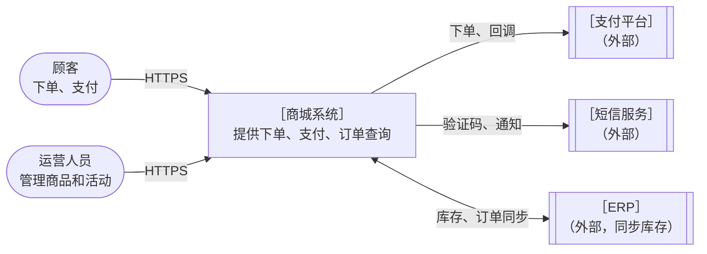
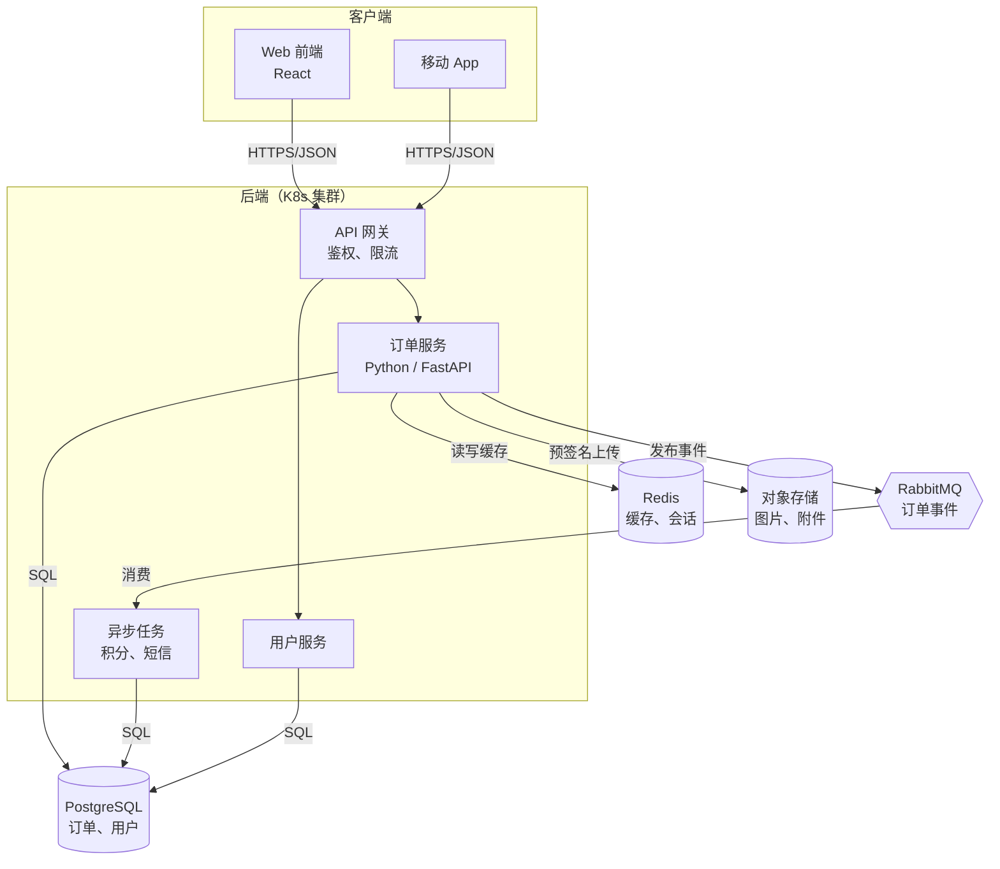
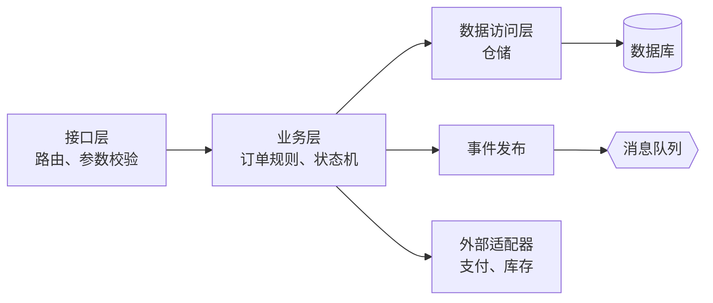
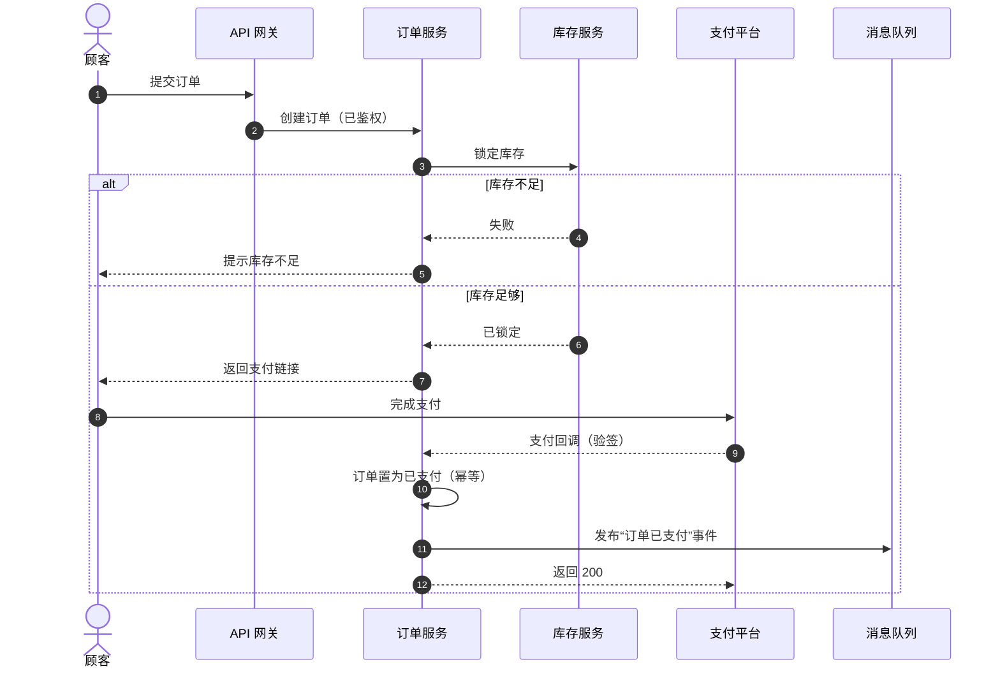
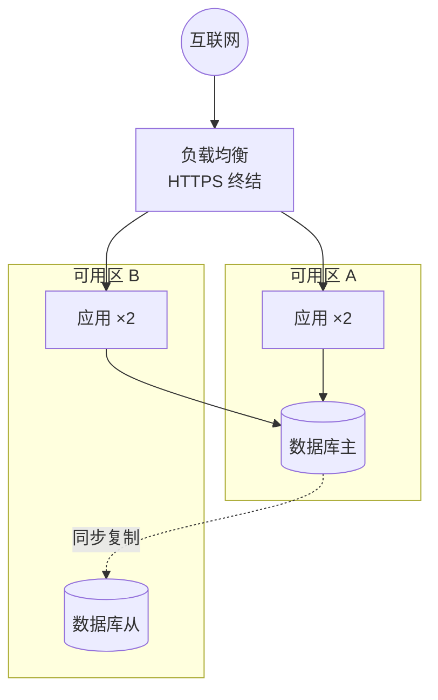
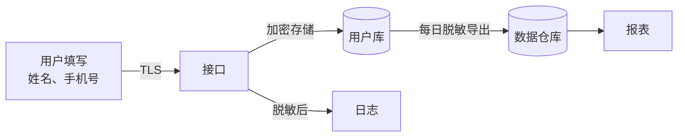

# 架构图模板（Mermaid）

把 `［…］` 里的内容换成真实名称。Mermaid 可在 Markdown 预览、GitHub、Gitea、多数文档工具里直接渲染。

## 1. 系统上下文图

回答“这个系统和谁交互”。系统只画一个框。

## 2. 容器图

回答“系统由哪些可部署单元组成”。线上写协议。

## 3. 组件图（一个容器的内部）

依赖方向只能从上到下；如果箭头出现回头，就是分层问题。

## 4. 时序图（关键流程，含失败分支）

要点：标出同步和异步（实线和虚线）、鉴权位置、失败分支、幂等位置。

## 5. 部署图

## 6. 数据流图（数据去哪了，合规评审常用）

## 7. 画图检查清单

- [ ] 一张图只讲一件事，框不超过 15 个
- [ ] 每个框有名称和一句职责，外部系统用不同形状标出
- [ ] 每条线有方向，容器图的线标了协议
- [ ] 同步和异步区分清楚
- [ ] 有数据存储，有谁读谁写
- [ ] 关键安全边界（公网、内网、认证位置）画出来了
- [ ] 图和代码核对过，写明日期和版本
