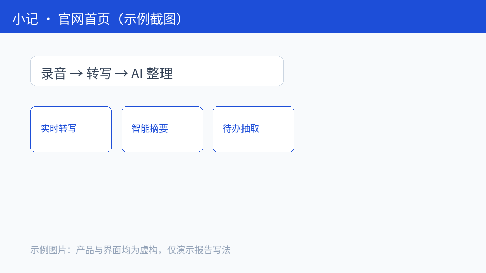
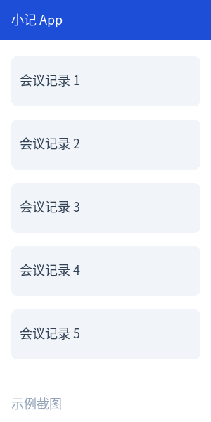
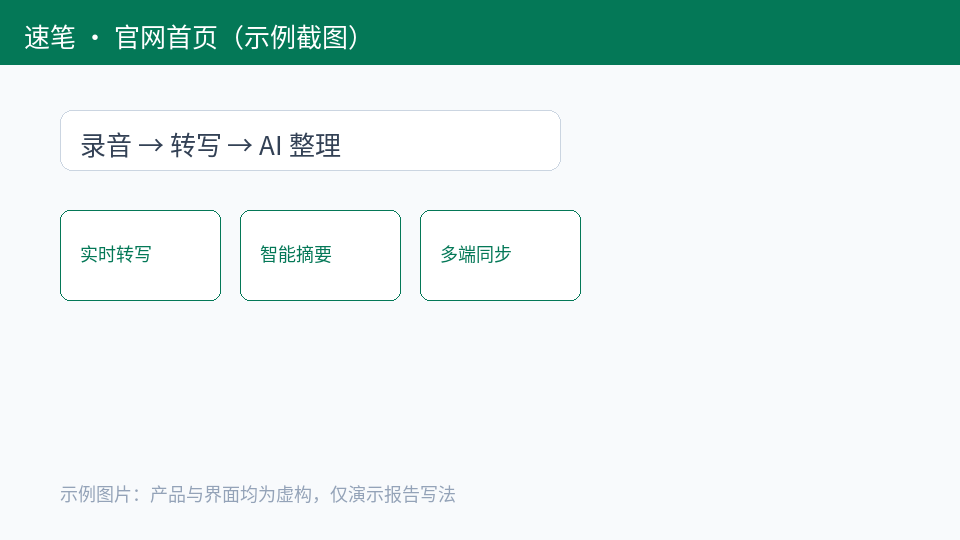
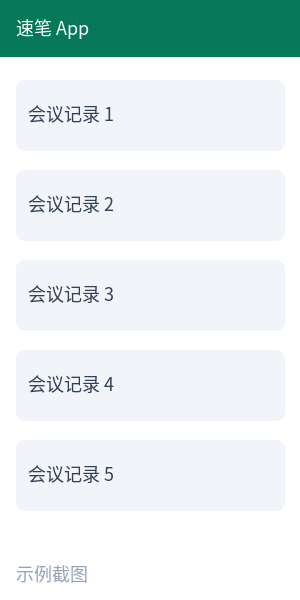
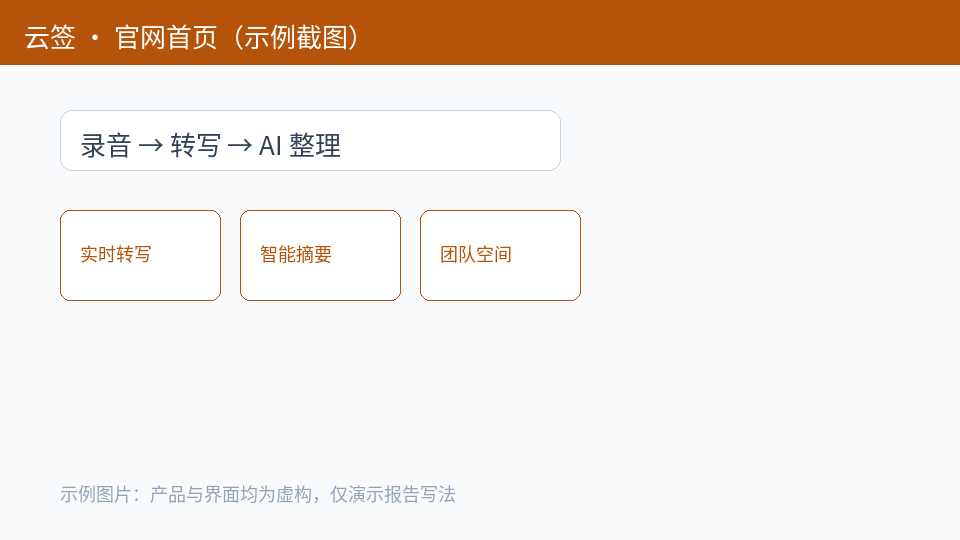
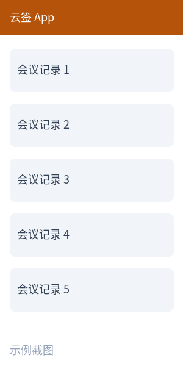

# 小记 vs 速笔、云签：AI 笔记产品竞品分析

## 一、核心结论

1. **速笔是最直接的对手**：同样主打“录音转写 + AI 整理”，App Store 评分 4.7（12.3 万人评分）高于小记的 4.2，差距主要来自转写准确率和多端同步体验 [1][4]。
2. **云签的护城河在协作而不是 AI**：团队空间和企业版占其收入大头，AI 功能是附加卖点；短期不会在个人市场与我们正面竞争 [2][5]。
3. **小记的机会在“会后行动”**：三款产品都能生成摘要，但只有小记能把待办自动同步到日历和任务工具；用户差评里“整理完还要手动建待办”出现 37 次，说明需求真实存在 [4]。
4. **价格不是突破口**：三家个人版月费都在 15–25 元区间，速笔已经提供 7 天免费试用，单纯降价难以形成差异 [1][2][3]。

## 二、分析范围与方法

- **竞品选择**：直接竞品速笔（同类功能、同一人群），间接竞品云签（协作笔记加 AI）；替代方案为“系统录音 + 通用 AI 助手”，在第五节简述。
- **评估方式**：AI 产品维度模板 8 个维度，1–5 分，每项评分在证据表中记录结论和来源；核心效果用同一组 20 段会议录音实测。
- **数据范围**：官网和定价页、App Store 应用信息与最新 300 条评论、产品实测（2026 年 10 月 15–18 日，iOS 18 / 安卓 15 各一台）。

## 三、竞品档案与概览

| 产品 | 定位 | 主要人群 | App Store 评分 | 个人版价格 | 最近更新 |
|------|------|----------|----------------|------------|----------|
| 小记（我方） | 会议记录到行动 | 职场个人 | 4.2（3.1 万） | 18 元/月 | 2026-10-12 |
| 速笔 | 录音转写 + AI 整理 | 职场个人、学生 | 4.7（12.3 万） | 22 元/月 | 2026-10-18 |
| 云签 | 团队协作笔记 | 中小团队 | 4.5（6.8 万） | 15 元/月 | 2026-10-09 |

来源：App Store 应用信息与各产品官网定价页，获取于 2026-10-20 [1][2][3]。

### 小记（我方）

- 官网：[https://xiaoji.example.com](https://xiaoji.example.com)；产品介绍页：[https://xiaoji.example.com/features](https://xiaoji.example.com/features)
- App Store：[小记](https://apps.apple.com/cn/app/example-xiaoji)，评分 4.2（3.1 万人评分），版本 2.8.0，上架 2024-03-15
- 官方介绍：“开完会，待办自动进日历”（官网首页，2026-10-20）
- 核心功能：实时转写、智能摘要、待办抽取并同步到日历和飞书任务等 4 个工具；个人版 18 元/月（来源：小记官网功能页与定价页，2026-10-20）

### 速笔

- 官网：[https://subi.example.com](https://subi.example.com)；产品介绍页：[https://subi.example.com/product](https://subi.example.com/product)；定价页：[https://subi.example.com/pricing](https://subi.example.com/pricing)
- App Store：[速笔](https://apps.apple.com/cn/app/example-subi)，评分 4.7（12.3 万人评分），版本 3.2.0，上架 2023-05-01
- 运营主体：示例速笔科技有限公司（官网页脚，2026-10-20）
- 官方介绍：“录音即笔记，AI 帮你记重点”（官网首页，2026-10-20）
- 核心功能：实时转写（支持 12 种方言）、智能摘要、多端同步（iOS、安卓、Windows、Mac）；个人版 22 元/月，7 天免费试用 [3]

### 云签

- 官网：[https://yunqian.example.com](https://yunqian.example.com)；定价页：[https://yunqian.example.com/pricing](https://yunqian.example.com/pricing)
- App Store：[云签](https://apps.apple.com/cn/app/example-yunqian)，评分 4.5（6.8 万人评分），版本 5.4.1，上架 2021-09-08
- 官方介绍：“团队的共享大脑”（官网首页，2026-10-20）
- 核心功能：团队空间、文档协同编辑、AI 摘要（2026 年 9 月新增）；个人版 15 元/月，团队版 39 元/人/月 [2][5]

## 四、分维度对比

### （一）核心效果

实测 20 段 30 分钟会议录音：速笔转写错字率 2.1%，小记 3.4%，云签 4.0%；摘要要点覆盖率三者接近，均在 85%–90% [6]。差距集中在多人交叉发言和专业术语，小记的人名识别错误最多。

### （二）任务完成度

小记能从会议内容中抽取待办，并同步到日历、飞书任务等 4 个工具；速笔和云签只生成待办列表，需要用户手动处理 [6]。这是小记目前唯一明显领先的维度。

### （三）口碑

最新 300 条评论中，速笔差评集中在“会员价格涨了”（21 次）和“导出格式少”（14 次）；小记差评集中在“转写不准”（42 次）和“整理完还要手动建待办”（37 次，主要来自尚未开启同步功能的老用户）[4]。

## 五、替代方案

“系统录音 + 通用 AI 助手”零成本，但需要用户自己上传、写提示词、复制结果，每次多花 5–10 分钟（实测 5 次平均 7 分钟）[6]。它限制了我们的定价上限，但不适合高频开会的用户。

## 六、建议

1. **（高优先级）补齐转写准确率**：针对多人发言和人名识别专项优化，目标三个月内错字率降到 2.5% 以下；对应结论 1。
2. **（高优先级）把“会后行动”做成主卖点**：新用户引导里默认开启日历和任务同步，投放素材与应用商店截图突出“开完会待办自动到日历”；对应结论 3。
3. **（中优先级）暂不跟进团队协作**：云签在团队市场有先发优势，我们先守住个人市场，半年后根据企业询单量再评估；对应结论 2。
4. **（低优先级）用试用代替降价**：上线 7 天免费试用，观察转化率，而不是调低月费；对应结论 4。

## 七、信息来源

1. App Store 应用信息：小记、速笔、云签（https://apps.apple.com/cn/app/example），获取于 2026-10-20
2. 云签官网定价页（https://example.com/yunqian/pricing），获取于 2026-10-20
3. 速笔官网定价页（https://example.com/subi/pricing），获取于 2026-10-20
4. App Store 最新评论各 300 条，product_search.py reviews，获取于 2026-10-19
5. 云签 2026 年产品发布会公开报道（https://example.com/news/yunqian-2026），2026-09-12
6. 团队实测记录：20 段会议录音转写与待办抽取测试，2026-10-15 至 10-18

**局限**：评论只代表近期用户；实测样本为中文普通话会议，不代表方言和英文场景；价格以获取当日官网为准。
