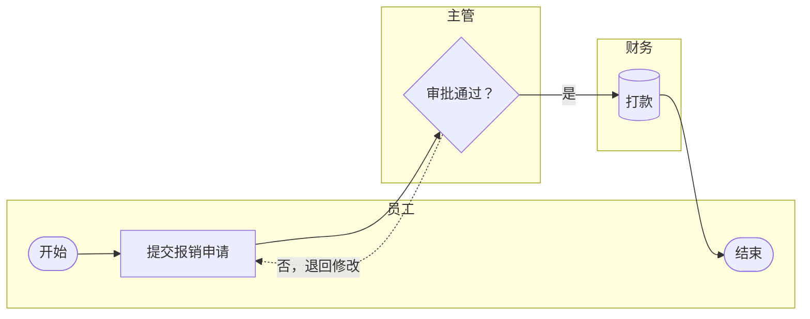

# Mermaid 绘图

完整语法速查见 `references/cheatsheet.md`（相对本技能目录）。

## 1. 选图型

| 用户要表达 | 图型 | Mermaid 关键字 |
|------------|------|----------------|
| 一个人/系统按步骤做事，有判断分支 | 流程图 | `flowchart TD` |
| 多个角色/部门之间交接 | 泳道图 | `flowchart LR` + 每个角色一个 `subgraph` |
| 系统/服务之间按时间顺序调用 | 时序图 | `sequenceDiagram` |
| 一个对象（订单、工单）的状态变化 | 状态图 | `stateDiagram-v2` |
| 多层条件判断得出结论 | 决策树 | `flowchart TD`（全部用菱形判断） |
| 组织结构、系统模块层级 | 层级图 | `flowchart TD`（无判断） |
| 发散想法、知识点梳理 | 思维导图 | `mindmap` |
| 项目排期 | 甘特图 | `gantt` |
| 数据表关系 | ER 图 | `erDiagram` |

拿不准时：有多个角色 → 泳道图；强调时间先后的系统交互 → 时序图；其余 → 流程图。

## 2. 编写规范

- **节点 ID 用短英文**（`submit`、`review`），文字放在括号里；不要用 `end`、`graph`、`subgraph`、`style`、`class` 之类关键字做 ID（最常见的报错原因）。
- **文字含标点或特殊符号时加双引号**：`A["提交（含附件）"]`。文字里需要双引号时写 `#quot;`。
- **不要用 ASCII 的 `<`、`>`**，导出 SVG 时会被吞掉；用"超过""低于"或全角 `＞` `＜` `≥` `≤`。
- 形状约定：
  - `([开始])` / `([结束])`：圆角，表示起止
  - `[处理步骤]`：矩形
  - `{判断？}`：菱形，写成问句
  - `[(数据库/系统)]`：圆柱
  - `[[子流程]]`：子流程
  - `[/输入输出/]`：平行四边形
- 连线：主流程 `-->`，带条件 `-->|是|`，回退/异常 `-.->|退回|`，强调 `==>`。
- 方向：步骤 ≤ 8 且无泳道用 `TD`；泳道图和长流程用 `LR`。
- 泳道图：每个角色一个 `subgraph id["角色名"]`，节点放进所属泳道；跨泳道连线写在所有 subgraph 之后。
- 需要突出关键节点时用 `classDef` 统一定义样式，不要逐个写 `style`。

## 3. 泳道图模板



## 4. 自检清单（交付前逐条过）

1. 每个判断节点的所有出口都有标签，并且都能走到终点；
2. 没有孤立节点，也没有无出口的死胡同（除结束节点外）；
3. 节点文字 ≤ 15 字，动词开头；
4. 回退线、异常线用虚线，与主流程区分；
5. 推测的步骤标〔待确认〕；
6. 已用 `diagram-export` 的 `--check` 校验语法通过。

## 5. 交付

- 网页端：回复中直接放 ```mermaid 代码块（会渲染成图），并保存 `outputs/diagrams/<名称>.mmd`。
- IM 渠道或需要图片：交给 `diagram-export` 导出 PNG。
- 需要在 draw.io 中编辑：交给 `drawio-diagram`。
