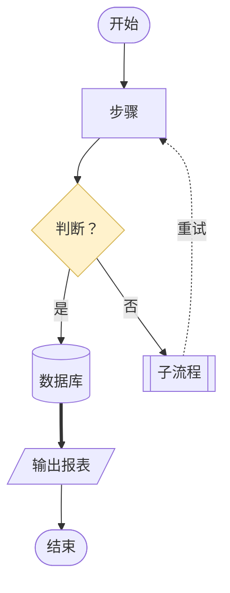
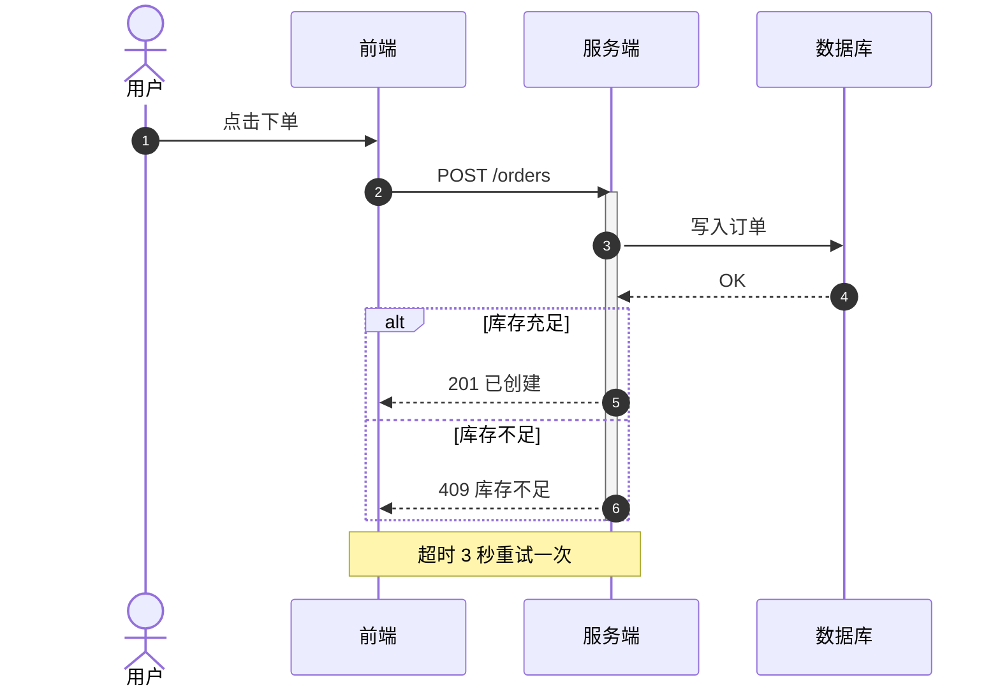
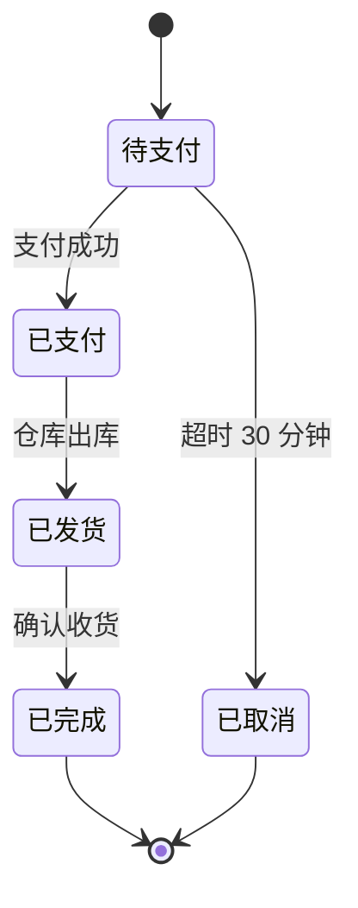
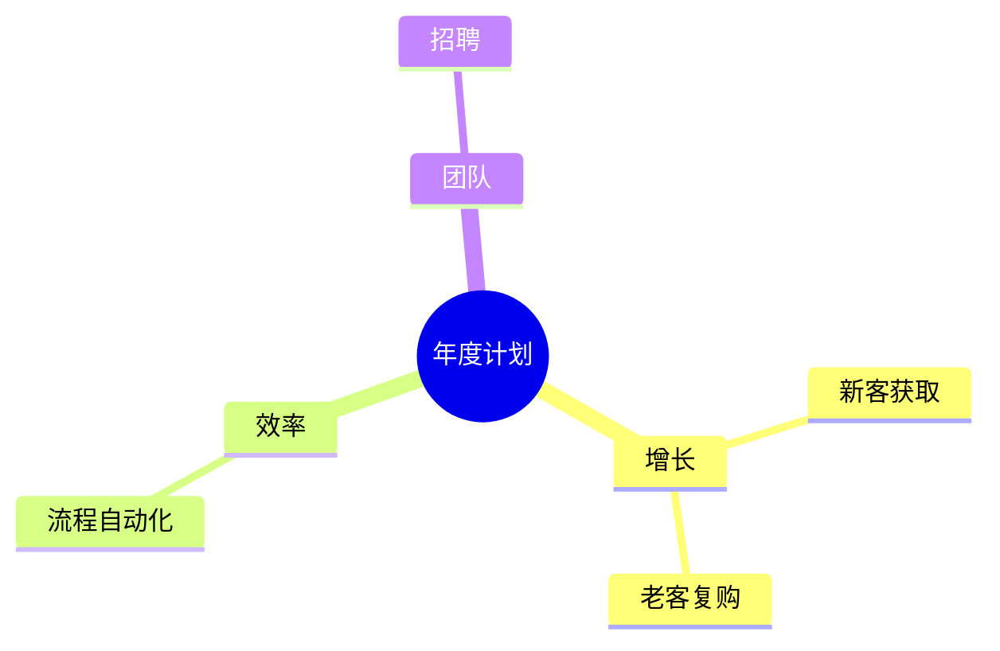
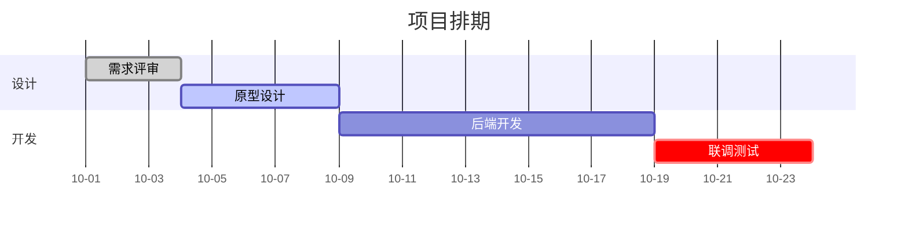
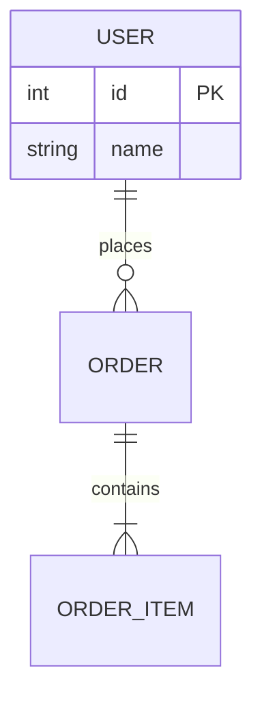

# Mermaid 语法速查（v11）

## 流程图 flowchart

方向：`TD`/`TB` 上→下，`LR` 左→右，`BT`、`RL` 反向。
子图：`subgraph id["标题"] ... end`；子图内可写 `direction LR`。
多目标：`a --> b & c`。注释：`%% 这是注释`。

## 时序图 sequenceDiagram

箭头：`->>` 实线请求，`-->>` 虚线返回，`-x` 失败，`-)` 异步。
分组：`alt/else/end`、`opt/end`、`loop 条件/end`、`par/and/end`。

## 状态图 stateDiagram-v2

## 思维导图 mindmap

缩进决定层级；根节点 `root((文字))`。

## 甘特图 gantt

## ER 图 erDiagram

## 常见报错

| 现象 | 原因 | 修正 |
|------|------|------|
| `got 'STADIUMSTART'` / `Expecting ... got 'end'` | 用了关键字做节点 ID（`end`、`graph` 等） | 换成 `done`、`finish` |
| `Parse error ... got 'PS'` | 文字里有未加引号的括号 | 加双引号：`A["说明（备注）"]` |
| 文字里 `>` 消失 | ASCII 尖括号被当作标记 | 改用"超过"或 `＞` |
| 中文标点导致断行异常 | 文字过长 | 缩短到 15 字内，或用 ` ` 手动换行 |
| subgraph 连线位置混乱 | 跨泳道连线写在 subgraph 内部 | 跨泳道连线统一写在所有 subgraph 之后 |
